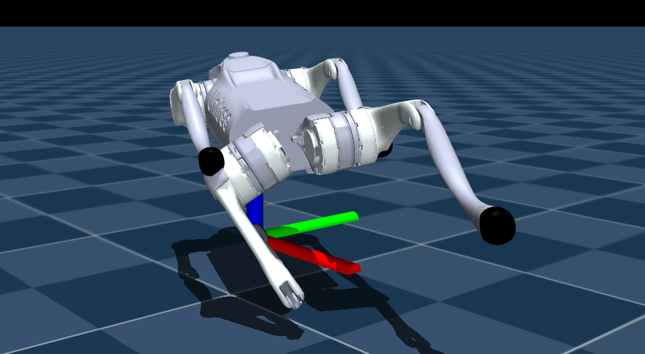

# Task 4 Reward v4 Implementation Report

## What changed

- Applied the `agent/reward_v4.yaml` reward design to the MASQ task.
- Updated planar linear and yaw-rate tracking to use the v4 exponential kernel
  plus a thresholded negative tail (`sigma=0.25`, threshold `0.2`, tail
  coefficient `2.0`).
- Replaced the v3 freeze-oriented `stand_still_penalty` and ramped survival
  bonus with `alive_moving` at scale `0.5`. It is active only for a nonzero
  planar command and returns `2*tanh(||v_b_xy||/0.1)-1`, so standing under an
  active command is negative while moving is positive.
- Kept the v4 stability, gait, and regularization terms registered in the MASQ
  environment, with the scales from `reward_v4.yaml`.

## Important decisions

- The YAML's `sigma_lin`/`sigma_yaw` values are interpreted directly as the
  denominator in the exponential (`0.25`), matching the specified equations.
- `alive_moving` uses measured base planar speed rather than joint speed, so it
  rewards actual locomotion and cannot be satisfied by joint jitter alone.
- Zero-command standing is neutral for `alive_moving`, as required by the
  command gate.

## Verification

- Passed Python bytecode compilation:
  `.venv/bin/python -m py_compile src/tasks/masq/mdp/rewards.py src/tasks/masq/masq_env_cfg.py`
- The project virtualenv does not contain `pytest`.
- The system `pytest` executable could not collect the existing tests because
  its interpreter lacks `torch` (`ModuleNotFoundError: No module named 'torch'`).

## Known limitation

The full simulator smoke test and pytest suite require the repository's ML
dependencies to be installed in the active test environment.

## Issues
The progress focused reward system has forced the quadruped to move, but thie issue is it launches all 4 legs at the same time, Hence making it fall. Now this issues is keeping this focus on movement and focusing on collaboration bw legs

Looking at graphs:

- as designed tracking is -ve and not only +ve which is desired 
- Episode mean reward has gone up (tho its -ve) while mean episode length goes down. which is not desired.
- One interesting thing is feet_stance_time penalty is 0. Hence this encouraged it to not plant it feet for long hence making it launch itself. This has to be adressed. 
- Major challenge is understanding the what the whole reward structure will cumulatively affect the performance before training.